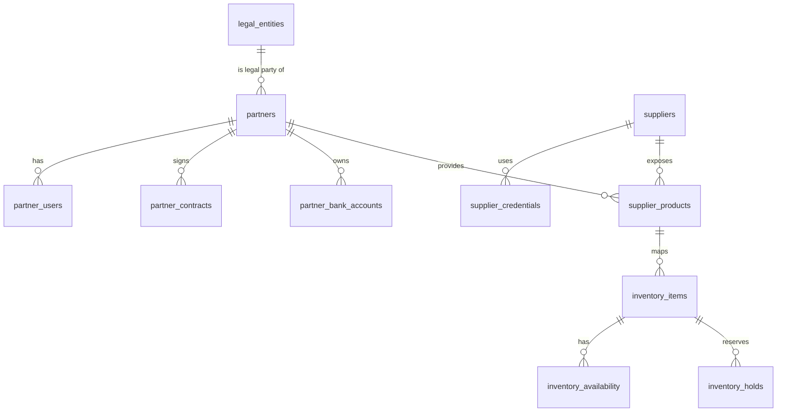
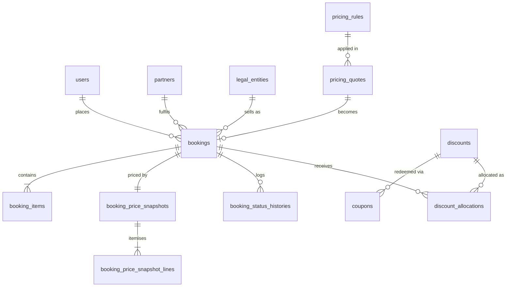
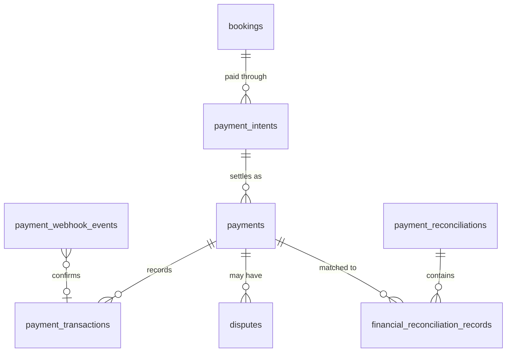
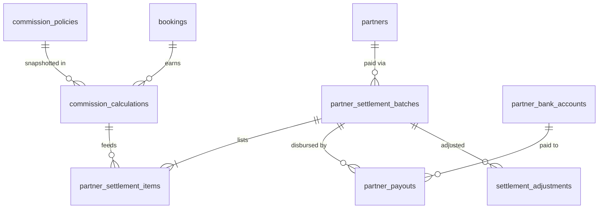
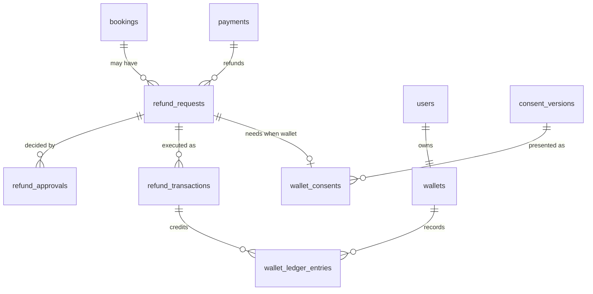
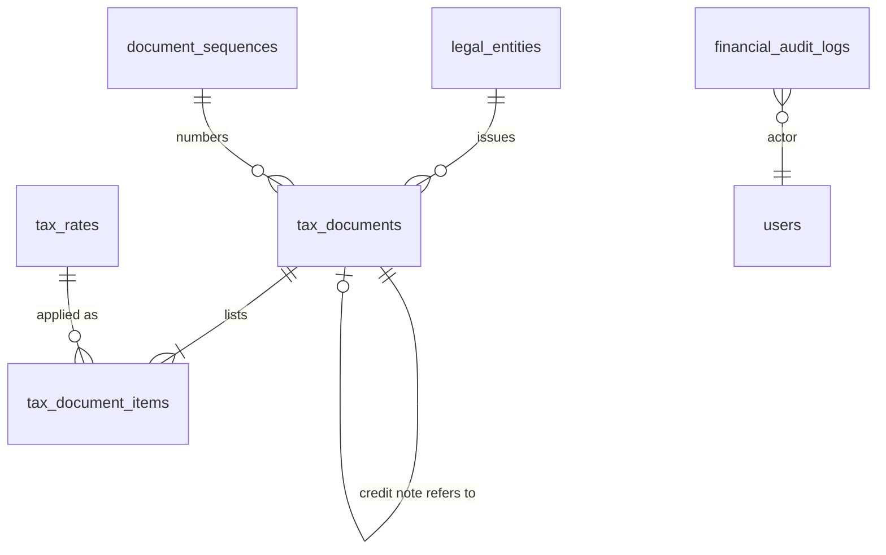

# 0003 — Financial ERD (Section 8.13 minimum entities + required additions)

Status: **DRAFT for review. Not a migration.** Names follow Section 8.13; entities marked **(+)** are additions the spec's behaviour requires (they go beyond the "at least" list). Entities marked **(ext)** extend a table that already exists in migration 000001.

## Conventions (apply to every financial table)

- `id CHAR(36)` UUID primary key; `created_at DATETIME(6)`; no `deleted_at` on financial tables (they are **append-only**; corrections are new rows).
- Money: `DECIMAL(14,2)` plus `currency_code CHAR(3)` (FK to `currencies (+)`, ISO 4217; THB only enabled at launch, so multi-currency needs no schema change). Rates: `DECIMAL(9,6)`. Never FLOAT/DOUBLE. The API transports money as decimal **strings**.
- Every row that records a business fact stores both our reference and the external reference (`external_reference`, `provider_reference`) where one exists.
- Mutable columns are limited to `status` (and `*_at` timestamps that record a status change). Status changes happen only in a transaction that also inserts the matching history/audit row.
- Immutability is enforced three ways: (1) the repository layer exposes insert and guarded transition only; (2) `BEFORE UPDATE`/`BEFORE DELETE` triggers on ledger-like tables raise an error (marked ▣ below); (3) the application DB user has no `DELETE` privilege on financial tables. Triggers and privileges **must be verified on a real MySQL** in CI.
- Snapshots (price, terms, commission, policy version, consent text) are copied into the row that uses them so later configuration changes cannot alter history.
- Secrets and card data: never stored. Supplier/PSP credentials live in a secret manager; the DB holds only a reference. Cards: PSP token/hosted page only; at most `brand` + `last4`.
- Sensitive columns (bank account numbers, taxpayer ids) are encrypted at the application layer with a managed key; only masked values are returned by the API.

## 1. Partner, supplier, inventory

| Entity | Key columns / constraints |
|---|---|
| `legal_entities` (+) | `entity_type` (PLATFORM/PARTNER), `legal_name`, `tax_id` (enc), `vat_registered` bool, `vat_effective_from`, `branch_code`, `registered_address`, `verification_status`. Used by tax documents and VAT display; the platform itself has one row. |
| `partners` (ext) | existing `owner_user_id`, `legal_name`, `status`; add `legal_entity_id`, `category_set`, `risk_level` (LOW/MEDIUM/HIGH), `approved_at`, `approved_by`. |
| `partner_users` | `partner_id`, `user_id`, `partner_role` (PARTNER_ADMIN/PARTNER_FINANCE), unique `(partner_id, user_id)`; scopes every partner-facing query. |
| `partner_contracts` | `partner_id`, `contract_no`, `version`, `starts_on`, `ends_on`, `seller_of_record` (PARTNER default / PLATFORM), `invoice_authorization` bool (platform may issue tax docs for partner — default false), `psp_fee_bearer` (PLATFORM/PARTNER/SHARED), `settlement_weekday` (default TUE), `reconciliation_days` (default 7), `commission_policy_id`, `status`, `legal_review_ref`. Contract changes = new version row. |
| `partner_bank_accounts` | `partner_id`, `bank_code`, `account_name`, `account_number_enc`, `account_last4`, `verified_at`, `verified_by`, `valid_from/to`; payouts only to a verified, currently valid account; every change audited. |
| `suppliers` | `supplier_type`, `adapter_code` (e.g. `internal`, `mock_flight`), `mode` (MOCK/SANDBOX/LIVE), `status`, `timeout_ms`, `max_retries`. |
| `supplier_credentials` | `supplier_id`, `secret_ref` (pointer into the secret manager), `rotated_at`. No plaintext. |
| `supplier_products` | `supplier_id`, `partner_id` NULL, `category` (HOTEL/TOUR/FLIGHT/TRANSPORT/ATTRACTION), `external_ref`, `internal_ref_type/id` (→ existing `hotels`, `tours`, …), `confirmation_mode` (INSTANT/MANUAL/ADAPTER), unique `(supplier_id, external_ref)`. |
| `inventory_items` (+) | `supplier_product_id`, `sku`, `capacity_unit`, `status`. |
| `inventory_availability` (+) | `inventory_item_id`, `service_date`, `quantity_total`, `quantity_sold`, `base_price DECIMAL`, `currency_code`; unique `(inventory_item_id, service_date)`; oversell blocked by a conditional `UPDATE … WHERE quantity_sold + ? <= quantity_total`. |
| `inventory_holds` (+) | short-lived reservation while payment is pending: `booking_id`, `inventory_item_id`, `service_date`, `quantity`, `expires_at`, `status` (HELD/CONSUMED/RELEASED). |

## 2. Booking and pricing

| Entity | Key columns / constraints |
|---|---|
| `bookings` (ext) | existing `user_id`, `booking_code` (unique), `currency_code`, `total_amount`, `status`; add `partner_id`, `seller_entity_id`, `price_snapshot_id`, `idempotency_key` (unique per user), `supplier_booking_ref`, `confirmation_deadline`, `expires_at`. `status` ∈ 8.15 booking states. |
| `booking_items` (ext) | `booking_id`, `supplier_product_id`, `partner_id`, `service_date`, `quantity`, `unit_amount`, `external_booking_ref`, `title_snapshot`. |
| `pricing_quotes` (+) | server-computed offer **before** booking: `user_id`, `items_json`, `amounts`, `supplier_ref`, `expires_at`, `revalidated_at`; a booking can only be created from an unexpired quote and must revalidate price + availability before payment (7.3, 8.3.2). If the supplier price changed, the customer must re-confirm (8.6.2). |
| `pricing_rules` | scoped by category/partner/date: markup/fees/taxes configuration; effective-dated; `rule_version`. |
| `booking_price_snapshots` ▣ | one per booking, immutable: `base_total`, `discount_total`, `tax_total`, `mandatory_fee_total`, `optional_fee_total`, `service_fee_total` (disabled by default, see 0002 Q1), `payable_total`, `currency_code`, `terms_json` (cancellation/refund policy at purchase), `supplier_price_ref`, `captured_at`. |
| `booking_price_snapshot_lines` ▣ | `snapshot_id`, `line_type` (BASE/DISCOUNT/TAX/MANDATORY_FEE/OPTIONAL_FEE/SERVICE_FEE), `label`, `amount`, `taxed_by_entity_id` (who charges the tax/fee), `vat_included` ∈ (YES/NO/UNVERIFIED — UI shows "VAT included" only for YES, 8.6.2). |
| `booking_status_histories` ▣ | `booking_id`, `from_status`, `to_status`, `actor_type/id`, `reason`, `request_id`, `created_at`. |
| `discounts` | rule definition: `owner_type` (PLATFORM/PARTNER), `owner_partner_id`, `discount_type` (FIXED/PERCENT), `value`, `min_booking_amount`, `max_discount`, `eligible_categories`, `valid_from/to`, `usage_limit_total`, `usage_limit_per_user`, `customer_eligibility`, `funded_by` (PLATFORM/PARTNER), `status`. |
| `coupons` (ext) | existing `promotion_id`, `code`, `expires_at`, `max_redemptions`; add `discount_id`, `redeemed_count`. Redemption counter updated with `UPDATE … WHERE redeemed_count < limit` (concurrency-safe). |
| `discount_allocations` ▣ | per booking: `booking_id` (unique ⇒ **one coupon per booking**), `discount_id`, `coupon_id`, `funded_by`, `amount`, `currency_code`. `funded_by` feeds the commission base (8.4.2: partner-funded discounts reduce it, platform-funded do not). |

## 3. Payment and reconciliation

| Entity | Key columns / constraints |
|---|---|
| `payment_intents` | created **before** redirecting the customer: `booking_id`, `user_id`, `provider`, `payment_reference` (unique, ours), `amount`, `currency_code`, `method` (PROMPTPAY_QR/CARD/SABAI_WALLET), `status` ∈ 8.15 payment states, `expires_at`, `idempotency_key` (unique), `provider_intent_id`. Amount is copied from the snapshot on the server; client amount is never read. |
| `payments` (ext) | existing `booking_id`, `user_id`, `payment_method_id`, `provider`, `provider_reference`, `amount`, `currency_code`, `status`; add `payment_intent_id`, `leg_no` (split tender: wallet leg + PSP leg), `captured_amount`, `refunded_amount` (cache, verified against `refund_transactions`), `succeeded_at`. A booking is PAID when the sum of SUCCEEDED legs = payable total. |
| `payment_transactions` ▣ | append-only PSP events: `payment_id`, `provider`, `external_id` (unique with provider), `event_type` (CHARGE/REFUND/VOID/…), `amount`, `status`, `raw_payload_hash`. |
| `payment_webhook_events` ▣ | `provider`, `event_id` (unique with provider ⇒ duplicate prevention), `signature_valid`, `event_timestamp` (replay window check), `received_at`, `payload_hash`, `processed_at`, `processing_result`. Signature is verified **before** anything else is stored as trusted. |
| `payment_methods` (ext) | `user_id`, `method_type`, `provider_token` (PSP token only), `brand`, `last4`, `status`. No PAN/CVV. |
| `payment_reconciliations` | `provider`, `period_from/to`, `source_file_ref`, `status`, `matched_count`, `unmatched_count`, `run_by`. |
| `financial_reconciliation_records` ▣ | `reconciliation_id`, `subject_type` (PAYMENT/REFUND/PAYOUT), `subject_id`, `provider_amount`, `our_amount`, `result` (MATCHED/MISSING_PROVIDER/MISSING_OURS/AMOUNT_MISMATCH), `resolved_by`, `resolution_note`. |
| `disputes` (ext) | existing; add `payment_id`, `dispute_type` (CUSTOMER/CHARGEBACK/FRAUD_ALERT). An open chargeback/fraud alert halts auto-refund and puts related settlement items ON_HOLD (8.10). |

## 4. Commission, settlement, payout

| Entity | Key columns / constraints |
|---|---|
| `commission_policies` | **versioned, never edited in place**: `scope` (DEFAULT/CATEGORY/PARTNER/CAMPAIGN), `partner_id`/`category`/`campaign_id`, `commission_type` (PERCENT/FIXED), `rate DECIMAL(9,6)` / `fixed_amount`, `effective_from/to`, `policy_version`, `supersedes_id`, `status`, `approved_by` (CFO/CEO). Seed row: DEFAULT, PERCENT, **0.05**, i.e. the 5% default exists as data (history of changes = the chain of versions). |
| `commission_calculations` ▣ | the 8.4.4 snapshot, one per booking item/event: `booking_id`, `partner_id`, `commission_policy_id`, `policy_version`, `commission_rate`, `commission_type`, `commission_base_amount`, `commission_amount`, `currency_code`, `calculation_timestamp`, plus `eligible_service_amount`, `partner_funded_discount`, `excluded_pass_through`, `kind` (ORIGINAL/REFUND_REVERSAL). Refunds insert negative reversal rows; history is never rewritten. Formula (8.4.2): base = eligible − partner-funded discount − excluded pass-through (VAT excluded automatically); commission = base × rate. Worked example from the spec (10,000 @5% → 500; partner net 9,500) is a mandatory unit test. |
| `partner_settlement_batches` | one per partner per cycle: `partner_id`, `period_from/to`, `gross_sales`, `commission_total`, `fees_total`, `refunds_total`, `net_amount`, `status` ∈ 8.15 settlement states, `on_hold_reason`, `created_by`, `reviewed_by`, `approved_by` (CHECK creator ≠ approver, enforced in service + trigger), `statement_document_id`. |
| `partner_settlement_items` ▣ | `batch_id`, `booking_id`, `commission_calculation_id`, `eligible_on` (service completed + reconciliation window), amounts, `on_hold` flag (open refund/dispute). Unique `(booking_id, kind)` ⇒ a booking cannot be settled twice. |
| `partner_payouts` | `batch_id`, `attempt_no`, `partner_bank_account_id`, `amount`, `status`, `payout_reference` (PSP/bank), `idempotency_key` (unique), `initiated_by` (≠ batch approver), `failed_reason`; unique `(batch_id, attempt_no)`; a batch may have only one non-FAILED payout (guarded transition) ⇒ **no duplicate payouts**. |
| `settlement_adjustments` ▣ | `batch_id`, `adjustment_type`, `amount` (signed), `reason`, `created_by`, `approved_by`. |

## 5. Refund, wallet, consent

| Entity | Key columns / constraints |
|---|---|
| `refund_requests` (replaces skeleton `refunds`) | `booking_id`, `payment_id`, `requested_by`, `reason_code`, `reason_text`, `requested_amount`, `calculated_amount` (from the **terms snapshot** + supplier answer), `approved_amount`, `currency_code`, `method` (ORIGINAL_METHOD / SABAI_WALLET — **no default to wallet**), `status` ∈ 8.15 refund states, `supplier_refund_status`, `psp_refund_status`, `risk_flag`, `auto_eligible`, `idempotency_key`. Rule enforced inside one transaction with `SELECT … FOR UPDATE` on the payment: `Σ(non-failed refunds) + new ≤ captured_amount`. |
| `refund_approvals` ▣ | `refund_request_id`, `approver_user_id`, `approver_role`, `decision` (APPROVE/REJECT), `limit_at_decision`, `reason`, `decided_at`; constraints: approver ≠ requester; high-risk ⇒ ≥2 distinct approvers; amount ≤ approver's `approval_limits`. Also written to `financial_audit_logs`. |
| `approval_limits` (+) | `role_code`, `max_amount`, `currency_code`, `effective_from/to`, `version` — the 3,000 / 5,000 / 50,000 matrix as data (DEC-08-12: internal proposal). |
| `refund_transactions` ▣ | one row per execution attempt: `refund_request_id`, `attempt_no`, `destination` (ORIGINAL_METHOD/SABAI_WALLET), `amount`, `status`, `psp_reference`, `wallet_ledger_entry_id`, `idempotency_key` (unique) ⇒ no duplicate disbursement. |
| `wallets` | `user_id` (unique per currency), `currency_code`, `balance_type` (`REFUND_CREDIT`), `balance` (cache; must equal Σ ledger), `status`. Internal service id `sabai_wallet`. |
| `wallet_ledger_entries` ▣ | 8.8.3 fields: `wallet_id`, `user_id`, `transaction_type` (REFUND_CREDIT / PAYMENT_DEBIT / ADJUSTMENT_CREDIT / ADJUSTMENT_DEBIT; TOPUP, TRANSFER, WITHDRAWAL **not allowed**), `reference_type`, `reference_id`, `credit_amount`, `debit_amount` (CHECK exactly one > 0), `balance_after` (CHECK ≥ 0), `currency_code`, `status`, `created_by`, `idempotency_key` (unique per wallet). A balance change without a ledger row and audit row in the same transaction is impossible by construction (stored in one service method, covered by trigger tests). |
| `consent_versions` (+) | versioned consent wording: `version`, `locale`, `text`, `text_sha256`, `legal_approved_by`, `legal_approved_at`, `effective_from`; production may only present a version with legal approval recorded (8.9.2 legal review gate). |
| `wallet_consents` ▣ | `user_id`, `booking_id`, `refund_request_id`, `consent_version_id`, `text_sha256_shown`, `presented_at`, `accepted_at`, `ip_address`, `device_info`; the wallet is never pre-selected, and execution of a SABAI_WALLET refund requires a matching row. |

## 6. Tax documents, audit, retention, go-live

| Entity | Key columns / constraints |
|---|---|
| `tax_documents` | `document_type` ∈ BOOKING_CONFIRMATION, PAYMENT_RECEIPT, TAX_INVOICE, COMMISSION_INVOICE, CREDIT_NOTE, REFUND_CONFIRMATION, SETTLEMENT_STATEMENT (8.7.2); `issuer_entity_id` (the legally responsible party), `recipient_name`, `recipient_tax_id`, `recipient_address`, `recipient_branch`, `document_no` (unique per issuer + series), `issued_at`, `taxable_amount`, `vat_amount`, `total_amount`, `currency_code`, `parent_document_id` (credit note → original), `booking_id`/`settlement_batch_id`/`refund_request_id`, `status` (DRAFT/ISSUED/VOIDED). **Issuance gate:** a TAX_INVOICE whose issuer is a partner may only be generated by the platform when `partner_contracts.invoice_authorization = true` *and* a legal-review reference exists (8.7.1, prohibition 5); otherwise the partner supplies/uploads it. Issued documents are immutable; fixes = credit note. |
| `tax_document_items` ▣ | line description, quantity, unit price, `tax_rate_id`, taxable amount, VAT. |
| `tax_rates` (+) | effective-dated, configurable without code: `tax_code`, `rate`, `effective_from/to`, `category_scope`. |
| `document_sequences` (+) | per issuer and series; gap-free allocation inside the issuing transaction. |
| `financial_audit_logs` ▣ | 8.11.2: `actor_user_id`, `actor_roles_json`, `occurred_at`, `entity_type`, `entity_id`, `field_changes_json` (before/after), `reason`, `reference_id`, `ip_address`, `device_info`, `request_id`, `prev_hash`, `row_hash` (hash chain for tamper evidence). No update/delete path in the UI or API; `UPDATE/DELETE` blocked by trigger and privileges. |
| `retention_policies` (+) | `data_class` (TAX_DOCUMENT, PAYMENT, REFUND, SETTLEMENT, WALLET_LEDGER, CONSENT, AUDIT, PERSONAL_DATA), `min_retention_years`, `legal_basis`, `status`. Only TAX_DOCUMENT/VAT = 5 years is filled (stated by the spec); all others `PENDING_LEGAL_REVIEW`. No automatic purge job exists until policies are approved (DEC-08-13). |
| `go_live_approvals` (+) | `approval_type` (PSP/LEGAL/ACCOUNTING/SECURITY), `approved_by`, `approved_at`, `evidence_ref`; checked by the production start-up guard (0002 §7). |
| `currencies` (+) | `code`, `minor_unit`, `enabled` (only THB enabled). |

## 7. Mapping of skeleton tables from migration 000001

| Existing skeleton (id + timestamps only) | Fate |
|---|---|
| `commissions`, `commission_transactions` | replaced by `commission_policies`, `commission_calculations` |
| `wallet_transactions` | replaced by `wallet_ledger_entries` |
| `cancellations` | folded into `booking_status_histories` + `refund_requests` (keep only if a separate cancellation record is wanted) |
| `refunds` | replaced by `refund_requests`/`refund_transactions` |
| `invoices`, `receipts` | replaced by `tax_documents` |
| `payment_logs` | replaced by `payment_transactions` + `financial_audit_logs` |
| `webhook_events` | replaced by `payment_webhook_events` |
| `partner_users`, `partner_documents` | `partner_users` extended; `partner_documents` kept for contract/KYC files |
| `coupon_redemptions` | superseded by `discount_allocations` |

None of these tables holds data today, so replacing them is a no-data-loss change now; it will not be after launch.

## 8. Constraints that must be tested on a real MySQL before approval

Unique keys (idempotency keys, `(provider,event_id)`, one coupon per booking, one settlement item per booking), CHECK constraints (MySQL 8.0.16+ enforces them), immutability triggers, `FOR UPDATE` ordering for refund and wallet concurrency, gap-free document numbering, and that the application DB user cannot DELETE financial rows.
